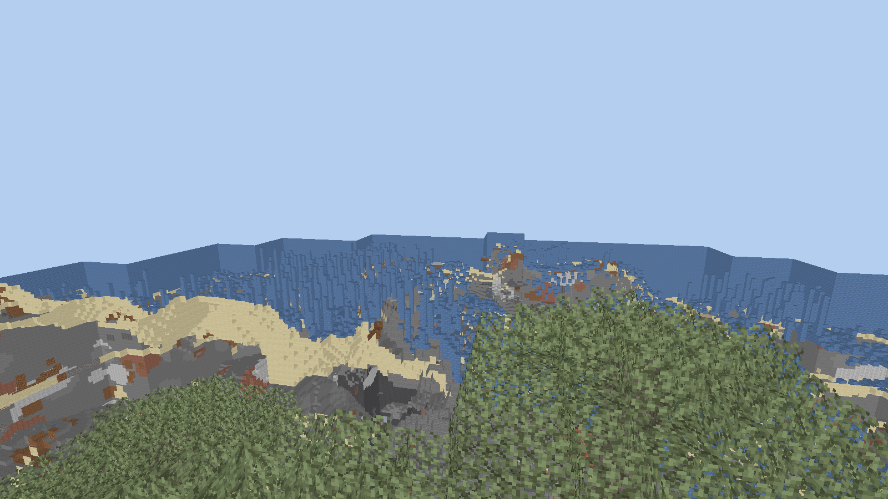
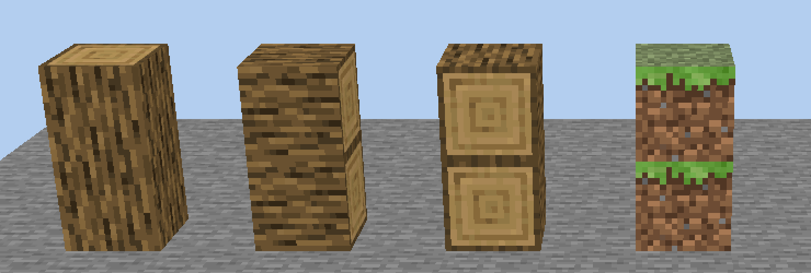

# Plasma Client

A Minecraft: Java Edition client written from scratch in C++23 and Vulkan.

Vanilla to the method, faster underneath. Plasma follows the vanilla client
method by method, translated from the game's own code into C++, and draws it
with a Vulkan renderer of its own. The goal is a client that feels like an
advantage the moment you start it, never like an imitation: see
[docs/GAMEPLAN.md](docs/GAMEPLAN.md).

How the game's behaviour is known: each developer decompiles the vanilla client
from their own copy, with Mojang's official mappings, on their own machine, and
the C++ translates it with the same order of operations, constants and random
draws. Small oracle programs run the game's own functions and ours on the same
inputs and compare the results bit for bit (`tools/oracle/run.py`). Decompiled
code, game files and the tables read from them never enter this repository and
never ship: they are baked from the player's own installation, and
`tools/check_public_tree.py` refuses them on every commit. See
[docs/METHOD.md](docs/METHOD.md).



## State

Not ready to play on yet. What works today:

- Signs in with a Microsoft account and joins real servers on protocol 774
  (1.21.11) and 776 (26.2).
- Movement and collision follow vanilla's code step by step: 14,394 values
  equal to the game's own, and a vanilla server sends no corrections while
  walking, sprinting, jumping, swimming, climbing or on ice and slabs.
- The world with vanilla's sky, fog, clouds, day and night, animated textures,
  water and lava (1,248 environment values equal to the game's).
- Other players with their skins, walking, looking, punching and sneaking, from
  the game's own model layers (1,776 vertices equal).
- Vanilla's HUD: hotbar, hearts, food, armour, air, experience, crosshair,
  chat, titles, boss bars, scoreboard and the player list.
- The survival and creative inventories, with clicks the server agrees with.
- Sounds picked the way the game picks them (2,832 picks equal), footsteps,
  music and ambience.
- Every item component, entity data type and recipe packet decoded.

Missing, and next in line: the title and pause screens, breaking-block
animation and particles, the hand and held items, icons for block items,
crafting results, non-full block outlines, texture mipmaps as vanilla builds
them, and smooth lighting.

Measured on an RTX 4070 Laptop with 16 threads, 1920x1080, 200 chunks of
overworld, 2.06 million triangles, 862k of them drawn after culling:

| | |
|---|---|
| frame, gpu | 0.257 ms |
| frame, cpu beside it | 0.275 ms mean, 0.116 ms median |
| 1% low, gpu | 0.335 ms |
| meshing | 0.17 ms per chunk, across 16 threads |
| vertex | 16 bytes |

Both halves are given on purpose. The gpu figure alone was published here for
a while, and it was the one part that was never the problem: a command buffer
and a fence were being allocated every frame, costing 0.854 ms of cpu against
0.164 ms of gpu. Quoting the gpu number by itself overstates the framerate by
about three times.

This still measures the draw path and nothing else - no game logic, no
entities, no interface - so it is not what a finished client will show.

Protocols 774 (1.21.11) and 776 (26.2) are supported, meaning a generated packet
table exists and a join against a real server of that version has been tested.

## Signing in

Joining a server in online mode needs a Microsoft account. The whole flow is
here - device code, Xbox Live, XSTS, Mojang, and the profile request that is
the actual proof the account owns the game - but a build has to carry an
application id of its own:

```sh
export PLASMA_MSA_CLIENT_ID=<your azure application id>
plasma-client login
```

Register the application under Microsoft Entra as a public client with the
device-code flow enabled; a client secret is neither needed nor wanted. Mojang
approves applications separately before they may sign players in for real.
Without an id the client says so and refuses rather than pretending.

A build configured with `-DMCPP_DEV_OFFLINE=ON` skips the ownership check and
can only join servers in offline mode. It is for testing and never ships.

## Building

Needs a C++23 compiler, CMake, Ninja, Vulkan headers and loader, glslang, and
zlib. Debug builds turn on AddressSanitizer and UBSan.

```sh
cmake -S . -B build -G Ninja -DCMAKE_BUILD_TYPE=RelWithDebInfo
cmake --build build
ctest --test-dir build --output-on-failure
```

Block geometry and textures are baked once from a Minecraft installation you
already own. `tools/find_minecraft.py` locates one; Modrinth App, Prism, MultiMC
and `~/.minecraft` are searched, and the version is confirmed from the jar rather
than from a directory name.

```sh
jar=$(python3 tools/find_minecraft.py 1.21.11)
python3 tools/bake_all.py "$jar" reports/blocks.json 774
```

That writes four files: block geometry, the texture array, the colour maps the
biome tints are looked up in, and the sky.

## Running

```sh
plasma-client login                            # sign in with a Microsoft account
plasma-client play <host>[:port]               # open a window and walk around
plasma-client join <host>[:port] [name]        # join and stay in the play state
plasma-client bench <host>[:port]              # frame time and fps
plasma-client walktest <host>[:port] [seconds] # walk the world with no window
plasma-client worldshot <host>[:port] out.png  # render the world to a file
plasma-client hudshot <host>[:port] out.png    # the same, with the hud over it
plasma-client menushot <host>[:port] out.png   # the same, with the menu over it
plasma-client showcase out.png <state>...      # render given blocks on their own
plasma-client gpu                              # adapters and features
```

In the window: WASD to move, mouse to look, space to jump, left control to
sprint, `f` to fly, `t` to chat, `m` for the feature menu, escape to leave.

`showcase` is how rendering bugs get found here. Blocks whose texture
orientation you know - a log, a grass block, a furnace - show a mistake at a
glance that a landscape hides completely.



## Packet ids are generated, never typed

The official server jar emits a report of every packet id; a script turns that
into a table holding every packet of every state, for every version given at once.

```sh
java -DbundlerMainClass=net.minecraft.data.Main -jar server.jar --reports --output out
python3 tools/gen_packet_ids.py 774=out/reports/packets.json 776=../26.2/out/reports/packets.json
```

It writes `include/mcpp/proto/packet_ids.hpp` and `src/proto/packet_ids_gen.cpp`
itself, and only once both are complete.

This is not tidiness. While this was built, the protocol wiki listed
`select_known_packs` as 0x0F and `code_of_conduct` as 0x14, where 774 and 776
use 0x0E and 0x13 - the wiki had moved on to a newer snapshot. A client built on
those numbers logs in nowhere.

Login and configuration ids happen to match between 774 and 776, but 102 of the
139 clientbound play ids differ, and field layouts move too: `accept_teleportation`
was one varint in both, and gained position and rotation fields in 26.3.

## What this is not

It does not ask for your Microsoft password, and never will. Signing in happens
through Microsoft's own flow or a session handed over by a launcher.

It gives no information and no input that the vanilla client does not have. No
reach, no aim assist, no auto-clicker, no velocity changes, no seeing through
blocks. Features a server forbids are switched off by the server, not merely
greyed out in a menu.

It is not ready to play on. See the state section above.

## Notes

`docs/ARCHITECTURE.md` is a running account of the decisions and of the bugs
that were worth writing down - a depth test that drew the back of the world, an
atlas that bled between tiles, a face winding that hid every top face.

## About

I'm Jerome, and I'm still in secondary school. Plasma is how I'm learning C++:
not through exercises, but by building something hard enough that every
shortcut shows.

I want to see what Minecraft can really do. The game runs on a client that
leaves a lot of speed on the table, and I want to know what it feels like when
every frame, every input and every chunk is as fast as the hardware allows,
without changing the game itself.

And I want to take Minecraft PvP in a new direction. Not with cheats, and not
with a client that only looks different, but with one that is exactly vanilla
where it counts and simply better everywhere else: lower input latency, no
stutter, instant joins. Something servers can allow and players notice. I'm
building that myself, in the open, with every number measured and published.

## Licence

GPL-3.0; see [COPYING.md](COPYING.md). The Plasma Client name and the marks in
`brand/` are excluded - fork the code, not the identity.
